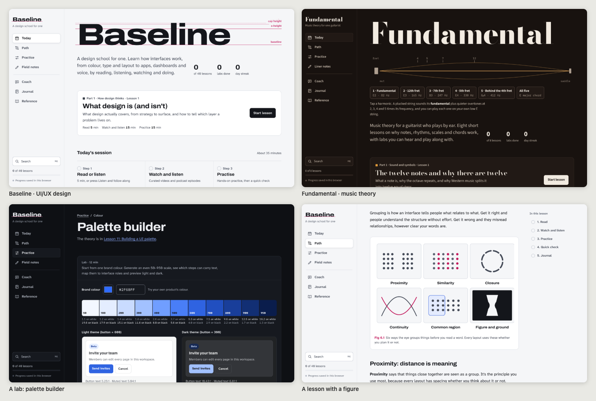

# My School

**An AI agent skill that builds you a personal school for any subject.**

Tell your agent what you want to learn. My School asks a few questions about your level, pace and goals, then builds an interactive learning site around you. It covers the fundamentals and the philosophy of the subject, and gives you real things to do with them.

[](https://skills.sh/Moe-G92/my-school)



## What you get

- **A path of lessons.** It starts with how experts think about the subject, then moves through fundamentals and techniques to real applications.
- **Every lesson in five steps:** read (with diagrams), watch and listen, practise, a quick check, and a journal prompt. Every video, podcast episode and article link is checked to exist before it is added.
- **Read-aloud** for every lesson and essay, with the paragraph being read highlighted.
- **Hands-on labs.** Simulators, fixers, perception trainers and small experiments that teach a principle by letting you push it until it breaks.
- **Short essays** on the big ideas of the subject, each readable in two minutes.
- **An AI coach** that answers questions, grades writing exercises and reviews your own work (a screenshot, a photo or pasted text). It runs on your own Claude account.
- **A journal, a glossary, cheat sheets, a reading library and search.** It's built to be your long-term reference.
- **Saved progress, light and dark themes, and it works on a phone.**

Two examples built with this skill: **Baseline**, a 40-lesson school on UI/UX design with 35 labs, and **Fundamental**, an 8-lesson music theory course for a guitarist who plays by ear, with labs you can hear. Baseline ships inside the skill as a complete worked example.

## Install

| You use | Quickest way |
|---|---|
| Almost any agent | `npx skills add Moe-G92/my-school` |
| Claude Code | `/plugin marketplace add Moe-G92/my-school` then `/plugin install my-school@my-school-marketplace` |
| Claude apps (web, desktop) | Download [my-school.zip](https://github.com/Moe-G92/my-school/releases/latest/download/my-school.zip) and upload it as a skill |
| GitHub Copilot | `gh skill install Moe-G92/my-school my-school` |
| Gemini CLI | `gemini skills install https://github.com/Moe-G92/my-school.git --path skills` |
| macOS or Linux, any agent | `curl -fsSL https://raw.githubusercontent.com/Moe-G92/my-school/main/install.sh \| bash` |

Details for each tool follow. The skill itself is the folder [`skills/my-school`](skills/my-school). Any tool that supports [Agent Skills](https://agentskills.io) can use it if you copy that folder into the tool's skills directory.

### Any agent: `npx skills`

The [skills CLI](https://skills.sh) detects the agents you have installed (Claude Code, Codex, Cursor, Copilot, Gemini CLI, OpenCode, Windsurf, Goose, Amp, Cline, Kiro and many more) and installs into each one:

```bash
npx skills add Moe-G92/my-school -g
```

Leave out `-g` to install into the current project instead of your user folder. Add `-a <agent>` to pick a single agent.

### Claude Code

As a plugin (easiest to keep updated):

```
/plugin marketplace add Moe-G92/my-school
/plugin install my-school@my-school-marketplace
```

Choose a scope when asked. From a terminal, `claude plugin marketplace add Moe-G92/my-school` and `claude plugin install my-school@my-school-marketplace` do the same.

Or copy the folder by hand. Claude Code picks it up without a restart:

```bash
git clone --depth 1 https://github.com/Moe-G92/my-school.git /tmp/my-school && mkdir -p ~/.claude/skills && cp -R /tmp/my-school/skills/my-school ~/.claude/skills/
```

For one project only, copy it to `.claude/skills/my-school` inside that project instead.

### Claude apps (claude.ai on the web and the desktop app)

1. Download [my-school.zip](https://github.com/Moe-G92/my-school/releases/latest/download/my-school.zip). Don't unzip it.
2. Open **Customize › Skills**, click **+**, choose **Create skill**, then **Upload a skill**, and pick the zip. On some versions this lives under **Settings › Capabilities**.
3. Code execution must be turned on. Custom skills are available on Free, Pro, Max, Team and Enterprise plans.

Skills don't sync between Claude Code, the Claude apps and the API, so install it in each place you use.

### Claude API and Agent SDK

- **Agent SDK:** put the folder at `.claude/skills/my-school` in your project, or at `~/.claude/skills/my-school`, and load the user and project setting sources (`setting_sources=["user", "project"]` in Python, `settingSources: ["user", "project"]` in TypeScript).
- **API:** upload the `skills/my-school` folder with the [Skills API](https://platform.claude.com/docs/en/build-with-claude/skills-guide) (`POST /v1/skills`), then pass its `skill_id` in the request's `container.skills`, together with the code execution tool. Building the site needs Node.js in the sandbox; this path is untested.

### OpenAI Codex

Copy the folder into `~/.agents/skills/` (all projects) or `.agents/skills/` in a project:

```bash
git clone --depth 1 https://github.com/Moe-G92/my-school.git /tmp/my-school && mkdir -p ~/.agents/skills && cp -R /tmp/my-school/skills/my-school ~/.agents/skills/
```

Or, inside Codex, ask: *Use $skill-installer to install https://github.com/Moe-G92/my-school/tree/main/skills/my-school*

### GitHub Copilot (VS Code, Copilot CLI, cloud agent)

```bash
gh skill install Moe-G92/my-school my-school --scope user
```

This needs GitHub CLI 2.90 or later (the command is in public preview). Without `--scope user` it installs into the current repository. You can also copy the folder to `~/.copilot/skills/` or `~/.agents/skills/`, or commit it under `.github/skills/` in a repository.

### Cursor

Copy the folder to `~/.cursor/skills/` or `~/.agents/skills/` (all projects), or `.cursor/skills/` in a project. Cursor also reads `~/.claude/skills/`, so a Claude Code install works here too.

### Gemini CLI

```bash
gemini skills install https://github.com/Moe-G92/my-school.git --path skills
```

Or copy the folder to `~/.gemini/skills/` or `~/.agents/skills/`.

### Other agents

| Agent | Copy `skills/my-school` to (user level) | Project level | Or |
|---|---|---|---|
| OpenCode | `~/.config/opencode/skills/` or `~/.agents/skills/` | `.opencode/skills/` | also reads `~/.claude/skills/` |
| Windsurf (Devin Desktop) | `~/.codeium/windsurf/skills/` or `~/.agents/skills/` | `.devin/skills/` | |
| Goose | `~/.agents/skills/` | `.agents/skills/` | |
| Amp | `~/.config/agents/skills/` | `.agents/skills/` | `amp skill add https://github.com/Moe-G92/my-school` |
| Kiro | `~/.kiro/skills/` | `.kiro/skills/` | Import a skill › GitHub › `https://github.com/Moe-G92/my-school/tree/main/skills/my-school` |
| Cline | `~/.cline/skills/` or `~/.agents/skills/` | `.cline/skills/` | |
| Letta Code | `~/.letta/skills/` | `.agents/skills/` | `letta install https://github.com/Moe-G92/my-school/tree/main/skills/my-school --agent <agent-id>` |

The folder must keep its name, `my-school`, because several tools require it to match the skill's name.

### One-line installer (macOS and Linux)

```bash
curl -fsSL https://raw.githubusercontent.com/Moe-G92/my-school/main/install.sh | bash
```

This copies the skill into `~/.agents/skills` (shared by most agents), into `~/.claude/skills` if you have Claude Code, and into `~/.kiro/skills` if you have Kiro. Add `-s -- --project` after `bash` to install into the current project, or `-s -- --uninstall` to remove it. [Read the script](install.sh) before running it if you like.

On Windows, use `npx skills add Moe-G92/my-school -g`, or copy `skills\my-school` into `%USERPROFILE%\.agents\skills\` (and `%USERPROFILE%\.claude\skills\` for Claude Code).

## Use it

Just ask, in your own words:

> I want to learn music theory from scratch. I play guitar by ear but can't read music. 20 minutes a day.

> Build me a school for personal finance, with videos, podcasts and exercises. I'm new to investing.

> Make me a go-to place to learn chess strategy, with interactive positions to practise on.

The agent asks up to four questions, plans the course, then writes it. Where the agent can run helpers in parallel, it splits up the lessons, glossary, essays and media research. It also builds the labs and a visual identity drawn from the subject itself, then tests the site and hands it to you. A short course (8 to 12 lessons) is quick; a full school (about 40 lessons) takes roughly an hour of the agent's time.

**Where the result lives**

- In **Claude** with artifacts (Claude Code desktop, claude.ai), it's published as a private artifact. Your progress and journal save to your account, and the coach works.
- In **other agents**, you get a single HTML page. It works in any browser and saves progress in that browser. The coach and the feedback on your work need Claude, so they show a notice instead.

## Requirements

- An agent that supports Agent Skills.
- Node.js 18 or later to build the site. Agents that run on your computer use your local Node.
- Optional: [Playwright](https://playwright.dev) for the automated checks (route sweep, phone-width layout, contrast in both themes, screenshots). The skill falls back to manual checks without it.

## What's in this repository

```
skills/my-school/
  SKILL.md                    the workflow the agent follows
  references/                 writing prompts, engine API, lab patterns, identity and publishing guides
  assets/engine/              the site engine: shell, exercises, storage, coach, read-aloud, search
  assets/templates/           starter config, theme, writing brief, and example lesson, lab and figure
  assets/examples/baseline/   the complete design school (40 lessons, 35 labs, 31 figures)
  scripts/                    init_project.mjs, build.mjs, check.mjs
.claude-plugin/               lets Claude Code install this repository as a plugin
install.sh                    one-line installer for macOS and Linux
```

To build the example school yourself:

```bash
node skills/my-school/scripts/init_project.mjs ./baseline --example baseline
```

```bash
node ./baseline/build.mjs
```

Then open `baseline/dist/preview.html` in a browser.

## Privacy

The sites this skill builds keep a learner's progress and journal in their own browser, or in their private storage inside a Claude artifact. Nobody else can read that, including people the page is shared with. The coach runs on the learner's own Claude account. Lesson links open third-party sites (YouTube, podcast hosts, publishers).

## Contributing

Issues and pull requests are welcome. New lab patterns, subject examples and installation notes for more agents are especially useful.

## Licence

MIT. See [LICENSE](LICENSE). The generated sites load [marked](https://github.com/markedjs/marked) and [DOMPurify](https://github.com/cure53/DOMPurify) from cdnjs, and fonts from Google Fonts, under their own licences. The media links in the example point to third-party videos, podcasts and articles, which remain their owners' work.
